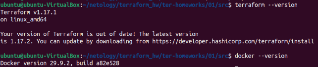
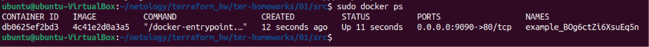
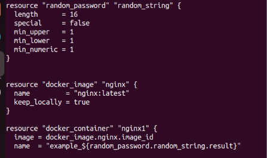
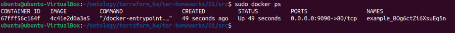
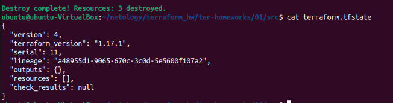

# netology_terraform_intro_hw
Домашнее задание к занятию «Введение в Terraform»

# Задание 0
Версия Terraform и Docker (пришлось менять ```required_version``` в ```main.tf```):


# Задание 1
* Секретная информация хранится в файлах вида *.tfstate. Они в целом служат хранилищем информации о созданной инфраструктуре (создаётся после первого успешного ```terraform apply```) и важен для сверки результатов ```terraform plan``` с актуальным состоянием. Кроме того, тут есть комментарий вида ```# own secret vars store```.
* Значение в terraform.tfstate: ```resources.instances.attributes.result: BOg6ctZi6XsuEq5n```
* Ошибки: для ресурса docker_image указан только тип, без имени (тип зависит от провайдера, которым может выступать Hashicorp, другой вендор (в нашем случае - "docker_image") или коммьюнити Terraform), указала имя **nginx**, т.к. далее в фале встречается ```docker_image.nginx.image_id```. Также имя ресурса не может начинаться с цифры. Переименовала второй ресурс в **nginx1**. Помимо этого ресурс random_password называется не ```random_string_FAKE```, а просто ```random_string```. Ну и ```resulT``` странно написано, исправила на ```result``` (опиралась на https://registry.terraform.io/providers/hashicorp/random/latest/docs/resources/password).
  
  
* ```-auto-approve``` по сути заменяет ручной ввод "yes", когда terraform выводит обновлённый план и предлагает его применить. Если в последний момент что-то решили исправить, то с данным флагом это уже поздно делать, т.к. процесс применения новых изменений уже запущен (также он включает уничтожение предыдущей сборки, что может быть критично). Документация (https://developer.hashicorp.com/terraform/cli/commands/apply) также говорит о том, что при использовании авто-апрува важно убедиться, что никто посторонний не имеет возможности менять вашу инфраструктуру. Имеется в виду, скорее всего, что если кто-то внесёт изменения в план, а применение изменений входит в какой-то конвейер CI/CD, который запускается автоматически, то изменения будут применены также автоматом (а там может быть что угодно, вплоть до удаления продовой базы данных), без предварительной ручной проверки.
  
* _
* Докер-образ не удалился из-за директивы ```keep_locally = true``` в ```main.tf```, то есть "хранить локально".
  Цитата (https://library.tf/providers/kreuzwerker/docker/latest/docs/resources/image):
  > keep_locally (Boolean) If true, then the Docker image won't be deleted on destroy operation. If this is false, it will delete the image from the docker local storage on destroy operation.
